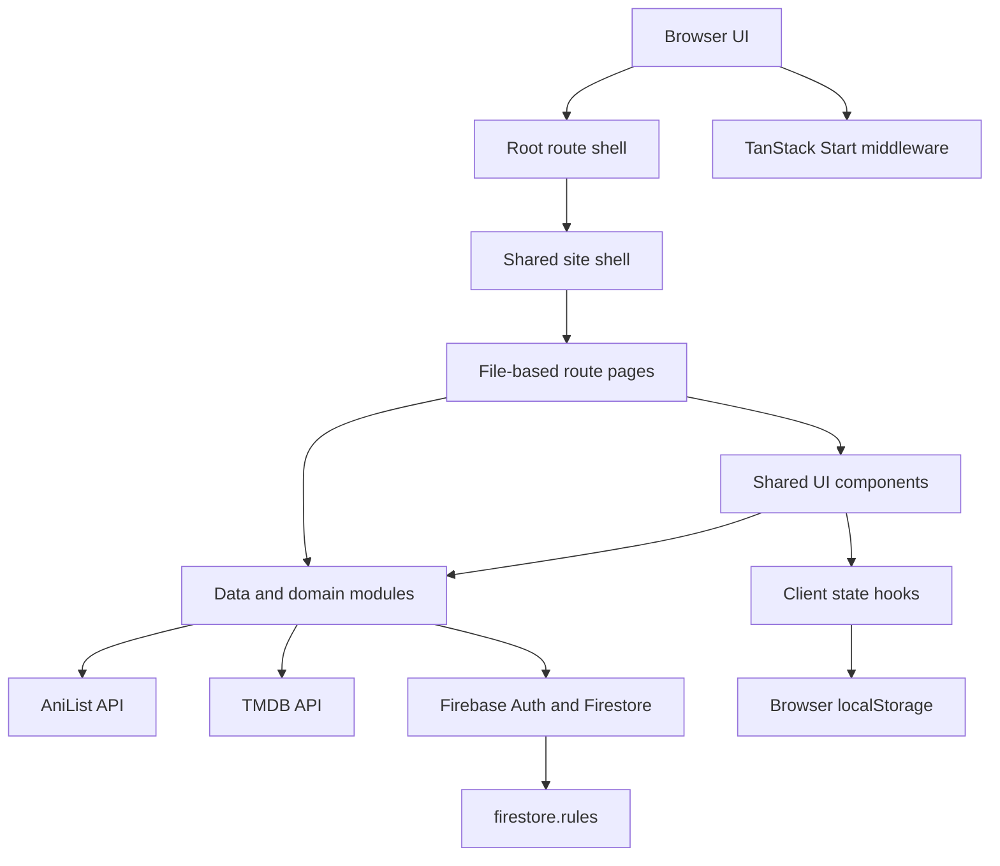

# TYSHI ZONE — Project Map

This map describes the v19.5 source package. Pages are file-based TanStack Start routes. Shared interface pieces live in `src/components`; reusable data and behavior live in `src/lib` and `src/hooks`.

## Page and feature map

| Route | Purpose | Main files |
| --- | --- | --- |
| `/` | Spotlight, continue watching, new releases, top airing, trending, and discovery rows | `src/routes/index.tsx`, `hero.tsx`, `continue-watching.tsx`, `latest-episodes.tsx`, `top-airing.tsx`, `anime-row.tsx` |
| `/anime/:id` | Anime overview, watch entry point, metadata, seasons, related titles, recommendations | `src/routes/anime.$id.index.tsx`, `franchise-sections.tsx`, `want-anime-button.tsx` |
| `/anime/:id/watch` | Embedded player, episode selection, language/server controls, anime info, seasons and related titles | `src/routes/anime.$id.watch.tsx`, `episode-player.tsx`, `video-player.tsx`, `franchise-sections.tsx` |
| `/anime/:id/edit` | Admin episode and title editing for one anime | `src/routes/anime.$id.edit.tsx`, admin episode editor components |
| `/watch` | Open or manage a direct video link | `src/routes/watch.tsx`, `video-player.tsx` |
| `/search` | Search results | `src/routes/search.tsx`, `src/lib/anilist.ts` |
| `/browse` | Browse and sort anime catalogs | `src/routes/browse.tsx`, `src/lib/queries.ts` |
| `/watchlist` | Saved titles | `src/routes/watchlist.tsx`, `src/hooks/use-watchlist.ts` |
| `/history` | Recently watched titles and playback progress | `src/routes/history.tsx`, `src/hooks/use-progress.ts` |
| `/admin` | Admin hub, imports, server templates, spotlight, settings, announcements and footer editor | `src/routes/admin.tsx`, `src/components/admin/hub.tsx`, `src/components/admin/site-announcements-editor.tsx` |

`src/routes/__root.tsx` provides the router document shell, global styles, favicon metadata, and root error/not-found handling. `src/components/site-shell.tsx` provides the shared navigation, search, settings, mobile navigation, editable public footer and announcement bell.

## Application flow

## Frontend structure

- `src/routes/`: page components and route loaders. The route files are the authoritative page entry points; `src/routeTree.gen.ts` is generated and should not be edited manually.
- `src/components/`: shared presentation and interaction components. `components/admin/` contains the admin hub and its focused tools.
- `src/hooks/`: browser state and subscriptions, including preferences, themes, progress, watchlist, catalog, spotlight and Firebase episode data.
- `src/styles.css`: global design tokens, themes, responsive behavior, motion, and scroll helpers. The video stage uses browser fullscreen behavior with the v17.1 fullscreen utility classes in `src/components/episode-player.tsx`.
- `public/`: favicon and install icons, logo assets, and crawler configuration.

## Data and backend responsibilities

The app uses Firebase from the browser for persisted catalog and admin data; this repository does not define a separate application database server. TanStack Start server middleware is in `src/start.ts`: it formats unexpected server errors and enables CSRF checks for server functions.

| Module | Responsibility |
| --- | --- |
| `src/lib/firebase.ts` | Lazy Firebase initialization, Auth/Firestore clients, configuration and readable error descriptions |
| `src/lib/cloud-episodes.ts` | Anime records, episode lists, servers, link selection, subscriptions and writes |
| `src/lib/bulk-import.ts` | Franchise import planning, season/episode mapping and bulk Firestore writes |
| `src/lib/tmdb.ts` | TMDB matching and season/episode mapping helpers used by admin tools |
| `src/lib/franchise-crawl.ts` | AniList relation traversal for franchise seasons, movies and specials |
| `src/lib/spotlight.ts` | Admin-managed Spotlight selections stored in Firestore |
| `src/lib/site-footer.ts` | Read and save the public footer text in Firestore |
| `src/lib/site-announcements.ts` | Public live announcement feed plus admin-managed dated items stored in `siteConfig/announcements` |
| `src/lib/server-replace.ts`, `series-mirror.ts`, `delete-series.ts` | Server-wide link updates, franchise mirrors and deletion workflows |
| `firestore.rules` | Public/admin access policy for Firestore collections; publish this file to Firebase when rules change |

Key Firestore collections include `anime`, `episodeLists`, `series`, `admins`, `siteConfig`, `adminConfig`, `adminLog`, `animeRequests`, `presence` and `siteStats`. Admin writes depend on Firebase Authentication and an `admins/{uid}` document; client code cannot override Firestore rules.

## Browser-persisted state

Theme choice, playback progress, watchlist, display preferences and some UI choices are kept in browser storage or client hooks. These values are separate per browser unless a feature explicitly syncs through Firestore. Announcements are live site-wide data; the notification bell records its read marker per browser.

## Where to make common changes

- Home layout or home row order: `src/routes/index.tsx`.
- Card and row interaction: `src/components/anime-card.tsx`, `latest-episodes.tsx`, `anime-row.tsx`, `drag-scroller.tsx`.
- Phone/desktop header and search behavior: `src/components/site-shell.tsx`, `src/components/header-search.tsx`.
- Watch page layout and source selection: `src/routes/anime.$id.watch.tsx`, `src/lib/cloud-episodes.ts`.
- Watch-page episode stills: prefer per-episode saved thumbnails, then number-matched legal stream thumbnails from AniList, then title artwork as fallback.
- Iframe/video rendering: `src/components/video-player.tsx`, `src/components/episode-player.tsx`. The ad-blocking iframe sandbox is controlled by `src/hooks/use-shield.ts` and must be changed only when explicitly requested.
- Fullscreen player sizing: browser Fullscreen API behavior and the stage utilities in `src/components/episode-player.tsx`; compare against the supplied v17.1 implementation before changing it.
- Seasons and related title layout: `src/components/franchise-sections.tsx` and season rules in `src/styles.css`.
- Global accent theme list and colors: `src/hooks/use-theme.ts` and `src/styles.css`. All themes retain a black page and neutral surfaces.
- Footer copy editor: `src/components/admin/site-footer-editor.tsx`, grouped in the Announcements admin section; Firestore persistence: `src/lib/site-footer.ts`.
- Announcement bell and feed: `src/components/announcements-popover.tsx`; admin editor: `src/components/admin/site-announcements-editor.tsx`; Firestore persistence: `src/lib/site-announcements.ts`.
- Bulk import flow: `src/components/admin/bulk-view.tsx`; server templates and link generation: `src/components/admin/server-list.tsx`, `src/lib/bulk-import.ts`.

## Package commands

- `npm install` — install dependencies from `package-lock.json`.
- `npm run dev` — start the Vite development server.
- `npm run build` — create the production build.
- `npm run preview` — preview the production build locally.

Firebase project settings are provided through `.env` and documented in `.env.example`. Release ZIPs include the user-supplied `.env` by explicit request, while installed dependencies and build caches are excluded.
